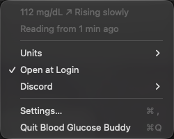
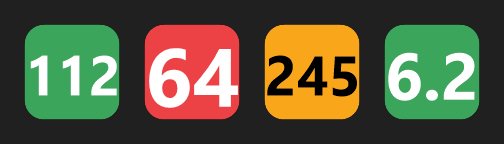
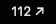
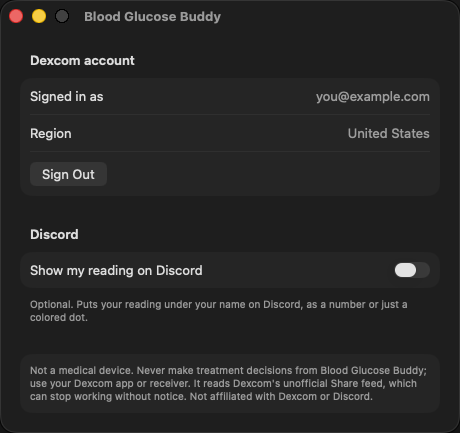
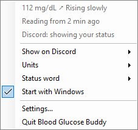
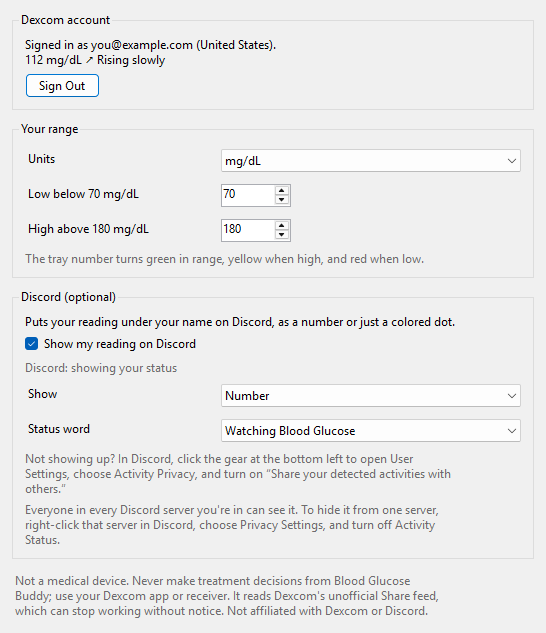
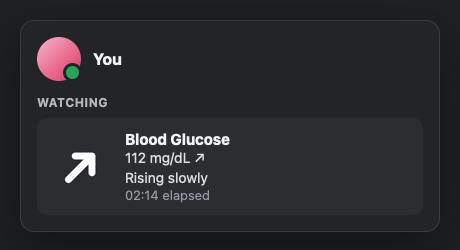
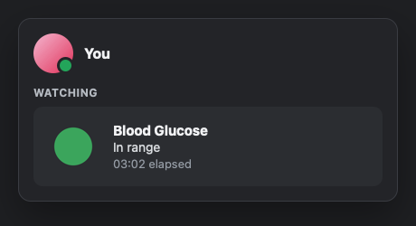

# Blood Glucose Buddy

Your live Dexcom reading and trend arrow in your Mac menu bar or Windows tray, always one glance away. Optionally on your Discord profile too.

Website: **[bloodglucosebuddy.tanookistudios.com](https://bloodglucosebuddy.tanookistudios.com)** · Setup guide with screenshots: **[docs/SETUP.md](docs/SETUP.md)**

| Mac menu bar | Windows tray |
|---|---|
|  |  |

- Your number and arrow next to the clock, refreshed every five minutes from Dexcom Share, the same live feed the Follow app uses. Starts when you log in.
- A reading older than 15 minutes shows as **No reading**, never as a stale number.
- mg/dL or mmol/L. On Windows the tray number turns green, yellow or red against your own high and low lines.
- Dexcom password in the macOS Keychain or Windows Credential Manager. No account, no server, no analytics.
- **Optional: Discord.** Turn on *Show on Discord* and your reading appears under your name, as the number or just a colored dot (In range / High / Low). Off until you turn it on.

**Free and open source, MIT licensed.**

> **Not a medical device.** Never make treatment decisions from Blood Glucose Buddy — use your Dexcom app or receiver. It reads Dexcom's unofficial Share feed, which can stop working without notice. Not affiliated with or endorsed by Dexcom or Discord.

## Download

| | |
|---|---|
| **Mac** (macOS 15+) | [Latest release](https://github.com/TanookiStudios/BloodGlucoseBuddy/releases/latest) — signed and notarized by Apple. |
| **Windows** (Windows 11) | **In testing.** A [test build](https://github.com/TanookiStudios/BloodGlucoseBuddy/releases/tag/v1.1.0-beta.3) is up; the full release follows once it's been tried on real PCs. Not yet code-signed, so Windows asks you to click **More info → Run anyway** the first time. |

Then follow the **[setup guide](docs/SETUP.md)**: turn on Dexcom Share and sign in. Discord is one more optional step.

## Screenshots

**Mac** — the menu bar, its menu, and settings:



| | |
|---|---|
|  |  |

**Windows** — the tray menu and settings:

| | |
|---|---|
|  |  |

**On Discord (optional)** — drawings of what Discord shows, made from the same pictures the app sends:

| Number mode | Colored dot mode |
|---|---|
|  |  |

Every screen is in the [setup guide](docs/SETUP.md). All screenshots come from automated runs with made-up readings (see below), never a real account.

## How it works

- **Dexcom:** Dexcom's official developer API delays data by an hour (three outside the US), so this reads **Dexcom Share** instead — the live feed the Follow app uses — with the user's own login. Share has to be on with at least one follower. Some accounts won't authenticate by email or phone; *Find My Account ID* opens Dexcom's own sign-in page and reads the account ID from the profile page address.
- **Discord (optional, off by default):** Rich Presence over the desktop app's local IPC (`$TMPDIR/discord-ipc-N` on Mac, the `\\.\pipe\discord-ipc-N` named pipe on Windows). One shared Discord application ("Blood Glucose", ID `1558184055437004933`) holds the arrow and dot pictures in `assets/discord/`. Setting a *custom status* from code would be a self-bot, which Discord bans, so this doesn't.
- **What's shown:** `mac/BloodGlucoseBuddy/Core/Presence.swift` and `windows/Core/Presence.cs` — the same rules, tested on both sides.

## Building

### Mac

macOS 15+, Xcode 26, [XcodeGen](https://github.com/yonaskolb/XcodeGen):

```bash
cd mac && xcodegen generate && open BloodGlucoseBuddy.xcodeproj
```

Not sandboxed: the Mac sandbox blocks Discord's local socket. To sign your own copy, change `DEVELOPMENT_TEAM` in `mac/project.yml`.

```bash
xcodebuild test -project mac/BloodGlucoseBuddy.xcodeproj -scheme BloodGlucoseBuddyTests -destination 'platform=macOS'
```

### Windows

.NET 10 SDK. Builds on Windows, Mac or Linux:

```bash
dotnet test windows/Tests
dotnet publish windows/App -c Release -o dist/win
```

`dist/win/BloodGlucoseBuddy.exe` is one self-contained file. The [Windows workflow](.github/workflows/windows.yml) builds it on a real Windows machine, runs the unit tests, runs `--self-test` (Credential Manager, the Start-with-Windows registry entry, the Discord pipe, Dexcom over HTTPS, tray icons), and renders the screenshots with `--screenshots`.

## Screenshots, regenerated

- **Mac:** `scripts/capture-screenshots-mac.sh` runs the UI tests in `mac/UITests`, which drive the real app with `BGB_DEMO=1`. That one switch gives the app throwaway settings, an in-memory password, made-up readings, and no Dexcom, Keychain, Discord or login item. The script fails if any screen is missing. The app is on screen for about a minute.
- **Windows:** the workflow's `--screenshots` step; download the `windows-build` artifact.
- **Discord drawings:** rendered from `site/style.css`.

## Releasing

1. Bump `MARKETING_VERSION` in `mac/project.yml` and `<Version>` in `windows/App/BloodGlucoseBuddy.csproj`, and add notes to the top of `site/versions.json`. After new Mac screenshots, copy `docs/screenshots/mac/05-menu.png` to `site/shots/mac-menu.png` (the site's front page).
2. `scripts/release-mac.sh` — tests, builds, signs, notarizes and zips into `dist/`.
3. Windows: `dotnet publish windows/App -c Release -o dist/win`.
4. `gh release create v<version> dist/BloodGlucoseBuddy-<version>-mac.zip dist/BloodGlucoseBuddy-<version>-windows.exe`
5. `node site/build.mjs --deploy`

## License

MIT. Made by Maddie at [Tanooki Studios](https://tanookistudios.com).
