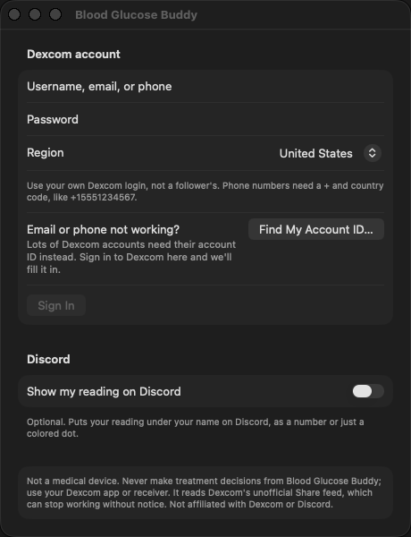
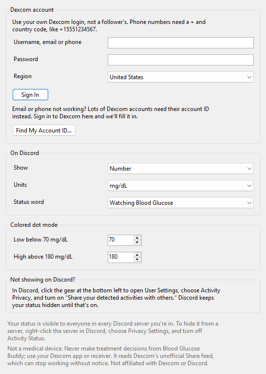
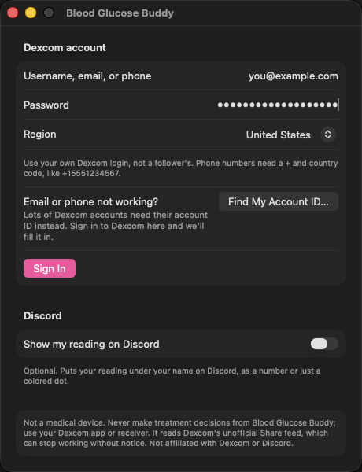

# Setting Up Blood Glucose Buddy

About five minutes, once. Screenshots of Blood Glucose Buddy itself come from an automated run with a made-up account and made-up readings. The Dexcom and Discord steps have no screenshots because they happen in those companies' own apps.

> **Not a medical device.** Never make treatment decisions from Blood Glucose Buddy — use your Dexcom app or receiver. Not affiliated with or endorsed by Dexcom or Discord.

## 1. Turn on Dexcom Share

Blood Glucose Buddy reads the same live feed your followers see, so Share has to be on. If someone already follows you in the Dexcom Follow app, it's on and you can skip this step.

1. Open the **Dexcom app** on your phone.
2. Tap the **Share** icon. It looks like two little people.
3. Turn **Share** on.
4. Invite one follower. Any email address of your own will do, and nobody has to accept the invite.

## 2. Install it

**Mac** (macOS 15 or later):

1. Download the latest Mac zip from the [Releases page](https://github.com/TanookiStudios/BloodGlucoseBuddy/releases).
2. Double-click the zip to unzip it.
3. Drag **Blood Glucose Buddy** into your **Applications** folder, then open it. It's signed and notarized by Apple, so it opens without warnings.

**Windows** (Windows 11):

1. Download `BloodGlucoseBuddy-…-windows.exe` from the [Releases page](https://github.com/TanookiStudios/BloodGlucoseBuddy/releases). It's a single file; there's nothing to install.
2. Open it. Until the app is code-signed, Windows shows a blue box saying **Windows protected your PC**. Click **More info**, then **Run anyway**. You only have to do this once.

## 3. Sign in with your Dexcom login

A sign-in window opens the first time. Use **your own** Dexcom login, the one you use in the Dexcom app, not a follower's. Phone numbers need a plus and your country code, like `+15551234567`.

| Mac | Windows |
|---|---|
|  |  |

Fill it in and press **Sign In**:

### If Dexcom won't accept your email or phone

A lot of Dexcom accounts only work here with their **account ID**, even when the password is right. You don't have to go hunting for it:

1. Press **Find My Account ID…** in the sign-in window.
2. Dexcom's own sign-in page opens inside the app. Sign in there.
3. When Dexcom shows your profile, the window closes and your account ID appears in the username box.
4. Type your password once more and press **Sign In**.

The app only reads the page address to pick up your ID. What you type on Dexcom's page goes to Dexcom, not to the app, and that sign-in is forgotten as soon as the window closes.

If Dexcom says your account is locked, that's from too many wrong passwords. Blood Glucose Buddy stops trying the moment a password is turned down, so it won't make it worse. Wait about half an hour and try again.

## 4. Let Discord show it

Discord hides activity from apps until you switch this on, on each computer:

1. In the **Discord desktop app**, click the **gear** at the bottom left, next to your name. That opens User Settings.
2. Under **Activity Settings**, choose **Activity Privacy**.
3. Turn on **Share your detected activities with others**.

## 5. Check it worked

Your number appears in the Mac menu bar, or on the tray icon by the Windows clock:

| Mac menu bar | Windows tray icon |
|---|---|
|  |  |

Then click your own picture in Discord. Under your name you'll see something like this (drawing):

The "elapsed" time is how old the reading is.

## 6. Change what's shown

Click the number in the Mac menu bar, or right-click the Windows tray icon:

| Mac | Windows |
|---|---|
|  |  |

- **Show on Discord:** your number, or **Colored dot only**, which shows In range, High or Low and never the number.

  

  

- **Units:** mg/dL or mmol/L.

  

- **Status word:** "Watching Blood Glucose" or "Playing Blood Glucose".

  

- **Open at Login / Start with Windows:** on by default after you sign in.

**Settings** has your account, the high and low lines for colored dot mode, and the Discord tips:

| Mac | Windows |
|---|---|
|  |  |

## Who can see it

Anyone who can see your Discord profile: friends, and people in every server you're in. To hide it from one server, right-click that server in Discord, choose **Privacy Settings**, and turn off **Activity Status**. Or use colored dot mode so nobody sees a number.

## Something's not right

- **It says No reading.** Your latest reading is over fifteen minutes old. The sensor may be warming up, or your phone lost signal. It picks back up by itself.
- **Nothing on Discord.** Check step 4, and that the Discord **desktop** app is open on the same computer. Discord in a web browser can't show it.
- **"Discord isn't open."** Open the Discord desktop app. Blood Glucose Buddy reconnects within 30 seconds.
- **Signed in, but no readings.** Dexcom Share is off, or has no follower yet. See step 1.
